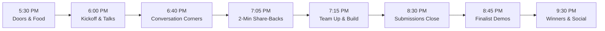

# SF Claude Impact Lab: AI Trust & Safety

**Date:** Tuesday, November 17, 2026
**Time:** 5:30 PM to 10:00 PM
**Venue:** Antler SF, 3rd Floor, 144 Townsend St, San Francisco, CA 94107 ([Open in Maps](https://www.google.com/maps/search/?api=1&query=Antler+144+Townsend+St+San+Francisco))
**Hosts:** Claude Community x Antler

> [!important] Critical Deadlines Tonight
> - **5:30 PM** Doors open, check in, food
> - **6:00 PM** Kickoff starts sharp
> - **7:15 PM** Form your team (up to 5 people) and start the 75-minute sprint
> - **8:30 PM** ==Pencils down. Submissions close and team cards handed to judges==
> - **8:45 PM** Finalist demos (3 minutes each, live on real data)

---

## Pages in This Guide

1. **[[SF Impact Lab Schedule]]**
   Full evening timeline from 5:30 PM to 10:00 PM, plus the minute-by-minute 60-minute build plan for the 7:15 PM sprint.
2. **[[SF Impact Lab Logistics and Setup]]**
   Venue details, what to bring, how to claim your Claude API credits without getting blocked, and where to get help in the room.
3. **[[SF Impact Lab Tracks Overview]]**
   Side-by-side comparison of all 6 tracks, datasets, and how to pick your corner at 6:40 PM.
   - [[Track 1 Agents in Inboxes]]
   - [[Track 2 Spot the Rogue Agent]]
   - [[Track 3 Robotaxis and Robots]]
   - [[Track 4 Privacy]]
   - [[Track 5 Personal Safety]]
   - [[Track 6 Room Challenge Wildcard]]
4. **[[SF Impact Lab Datasets Catalog]]**
   Quick reference table for every public dataset in the starter repo (`datasets.json`), how to pull them, and data traps to watch out for.
5. **[[SF Impact Lab Submission and Judging]]**
   How to register your team, the online submission form vs. the repo `SUBMISSION.md` card, the 4 judging criteria, and a ready-to-fill worksheet.

---

## Evening Flow at a Glance

---

## Quick Links

- **Participant Hub:** [claudesocal.com/sf-impact-lab](https://claudesocal.com/sf-impact-lab)
- **Conversation Corner Cards:** [claudesocal.com/sf-impact-lab/cards](https://claudesocal.com/sf-impact-lab/cards)
- **Starter Repository:** [github.com/sergeicu/trust-safety-impact-lab](https://github.com/sergeicu/trust-safety-impact-lab)
- **Event Page (Luma):** [luma.com/claude-sf-impact-lab](https://luma.com/claude-sf-impact-lab)
- **Anthropic Console (for Org ID):** [console.anthropic.com](https://console.anthropic.com)
- **Post-Event Story Form:** [Share your story from tonight](https://form.typeform.com/to/hyZ2E0qx?typeform-source=qrcode-button)
