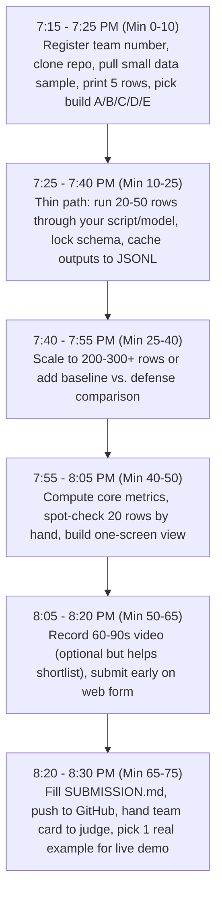

# SF Impact Lab Schedule

← Back to [[SF Impact Lab Index]]

---

## Phase 1: Arrival & Framing (5:30 PM to 6:40 PM)

| Time | Duration | Session | What Happens & Your Action |
| :--- | :--- | :--- | :--- |
| **5:30 PM** | 30 min | **Doors Open, Check-In & Food** | Head to the 3rd floor at 144 Townsend St. Grab food, connect to Wi-Fi, plug in your charger, and claim your Claude API credits (see [[SF Impact Lab Logistics and Setup]]). |
| **6:00 PM** | 10 min | **Welcome from Your Hosts** | Kickoff starts sharp. Grab the kickoff slide link and API credit claim link shared in the room. |
| **6:10 PM** | 15 min | **Security Talk from Anthropic** | Context on current AI security, trust, and agent safety problems. |
| **6:25 PM** | 15 min | **Framing the Night: Who Decides the Rules?** | How the evening works, how conversation corners feed into builds, and what judges look for. |

---

## Phase 2: Conversation Corners & Team Formation (6:40 PM to 7:15 PM)

| Time | Duration | Session | What Happens & Your Action |
| :--- | :--- | :--- | :--- |
| **6:40 PM** | 25 min | **Conversation Corners** | Walk to the corner for the track you care about most (see [[SF Impact Lab Tracks Overview]]). Talk with your circle and fill out one card together at [claudesocal.com/sf-impact-lab/cards](https://claudesocal.com/sf-impact-lab/cards): *"How might we help [who] do [what] so that [outcome]?"* |
| **7:05 PM** | 10 min | **Share-Backs (2 Minutes Each)** | Each corner shares its core problem statement with the whole room. Organizers paste room concerns into the shared list for [[Track 6 Room Challenge Wildcard]]. |

---

## Phase 3: The Build Sprint (7:15 PM to 8:30 PM)

> [!tip] 75 Minutes Total
> You have 1 hour and 15 minutes from team formation to pencils down. Mentors roam the room all night—wave one over as soon as you hit a blocker.

| Time | Duration | Session | What Happens & Your Action |
| :--- | :--- | :--- | :--- |
| **7:15 PM** | 75 min | **Start Your Team & Build** | Form a team of up to 5 people (solo is fine). Register your team email on the [Participant Hub](https://claudesocal.com/sf-impact-lab#team) in 30 seconds to get your **Team Number** (`Team 1`, `Team 2`, etc.). Clone the starter repo and build. |
| **8:30 PM** | — | **Submissions Close (Hard Stop)** | Pencils down. Submit on the web form, push your repo with `SUBMISSION.md` filled in, and hand your team card to a judge. Judges review submissions and shortlist finalists. |

### The 60-Minute Build Playbook (Inside the 7:15 PM Sprint)

---

## Phase 4: Demos, Judging & Social (8:30 PM to 10:00 PM)

| Time | Duration | Session | What Happens & Your Action |
| :--- | :--- | :--- | :--- |
| **8:30 PM** | 15 min | **Judges Shortlist** | Judges read every submission and team card to pick the finalists (3 to 10 teams) they want to see live. |
| **8:45 PM** | 45 min | **Finalist Demos** | Selected finalists present to the room (3 minutes each, no extra prep time): state the concern, show the tool working live on real data, and name one honest limitation. |
| **9:30 PM** | 15 min | **Winners, Photo & Next Steps** | Judges score finalists and announce winners. Group photo and community announcements. |
| **9:45 PM** | 15 min | **Social Until 10:00 PM** | Wrap up conversations, exchange contacts, and fill out the 2-minute [story form](https://form.typeform.com/to/hyZ2E0qx?typeform-source=qrcode-button) before heading out. |

---

## Related Notes
- [[SF Impact Lab Index]]
- [[SF Impact Lab Logistics and Setup]]
- [[SF Impact Lab Tracks Overview]]
- [[SF Impact Lab Submission and Judging]]
